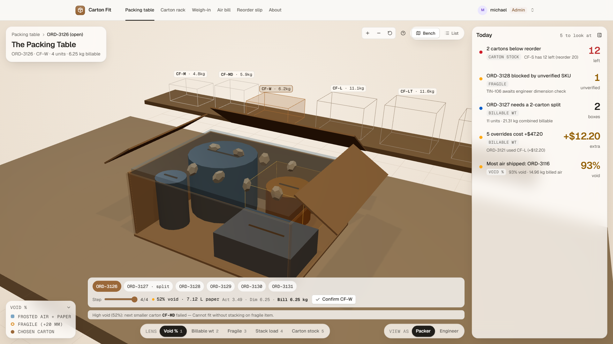

# Carton Fit

Give the bench an order and Carton Fit finds the smallest in-stock carton the items truly fit in, with fragile cushioning and keep-upright rules honoured, shows the frosted void space and billable dimensional weight, and keeps carton stock ahead of lead time.




## This repository

```text
apps/carton-fit/   the app: React + Vite frontend, Rayfin data model (rayfin/), tests, demo walkthrough
shared/         shared package (@x10/shared): data store, sign-in runtime, UI kit, charts
tools/          deploy, seed, SQL and secrets-check scripts
```

Quick start (no Fabric tenant needed, runs in demo mode with sample data):

```bash
npm install
npm run dev
```

## The problem & standard

In peak fulfilment, packers grab an oversized box to be sure everything fits. The warehouse pays carrier dimensional weight on empty air, exhausts the one popular carton size, and risks placing a heavy kettle over a fragile glass ornament. Carton Fit applies the standard parcel carrier volumetric weight formula (`outer L × W × H in cm³ ÷ 5000 kg`, where a `400 × 300 × 200 mm` outer carton is `24,000 cm³ → 4.8 kg`) and picks the least billable cost among safe 3D placements.

## What it looks like

The home centrepiece is **the packing table** (lazy-loaded Three.js): an open corrugated carton sits on a warm wooden bench under a single overhead lamp while generated boxes and cylinders drop in placement order, unused headroom glows as frosted air with crinkled kraft paper, and a candidate carton rack behind the bench lifts and highlights the optimal box.

- **Lenses (`1`–`5`):** Void %, Billable wt, Fragile, Stack load, Carton stock.
- **Tools:** Packing table, Carton rack, Weigh-in, Air bill, Reorder slip, About.
- **Fallbacks:** `?nowebgl` and reduced-motion render three orthographic SVG slice views (top, front, side) with identical placements; `L` toggles an accessible table of the same pack plans.

## Prerequisites

- Microsoft Fabric Apps workload enabled in your workspace on an active capacity.
- Workspace Edit permission to deploy the app and database schema.
- Node.js 20+.

## Run locally

```bash
npm install
npm run dev --workspace=@x10/carton-fit
```

`npm run dev` starts demo mode on port `5254` with deterministic seed data and the persona switcher (Packaging engineer and two Packers). Use `npm run dev:fabric --workspace=@x10/carton-fit` to run against a local Rayfin backend.

## Deploy

```bash
cd apps/carton-fit
npx rayfin up --workspace-id <your-workspace-id>
```

## Seed & admin setup

```bash
npm run seed:fabric --workspace=@x10/carton-fit -- --admin-email you@org.com
```

The seed script populates 12 cartons (including a tube, flat mailer, and two cartons below reorder), 60 SKUs (8 fragile, 3 unverified), and 40 orders across the last three days. Grant packaging-engineer privileges by setting `isAdmin = 1` on the user's `Person` row.

## How it works

| Entity | Purpose | Row security |
| --- | --- | --- |
| `Carton` | Standard box dimensions, tare, max load, cost, stock, reorder point | Authenticated read; admin writes enforced in domain |
| `Sku` | Product dimensions, weight, fragile, keepUpright, stackLimitGrams, verified | Authenticated read; admin verify & weigh-in unverify in domain |
| `PackOrder` | Customer order ref, status (`open`/`packed`), packerSub, packedAt | Authenticated read/create; claim & owner update in domain |
| `PackLine` | Order line linking `packOrderId`, `skuId`, `qty` | Authenticated; order-linked checks in domain |
| `PackPlan` | Immutable confirmed plan with compact placements JSON and weights | Authenticated read; `create` requires `claims.sub.eq(item.packerSub)`; no update/delete |

Pure rules in `src/domain/packing.ts` enforce `CUSHION_MM = 20`, `WALL_MM = 6`, `DIM_DIVISOR = 5000`, `VOID_WARN = 40%`, `FILL_FACTOR = 0.5`, `WEIGH_TOLERANCE = 5%`, and `CARTON_LEAD_DAYS = 5`.

## Known limits

- Admin-only restrictions on `Carton` and `Sku` writes and `PackOrder` claim transitions are enforced in `src/domain/cartonFit.ts` because Rayfin DAB row policies cannot join across `Person.isAdmin` or compare nullable owner columns prior to claim.
- The 3D packer uses a deterministic first-fit-decreasing extreme-point heuristic rather than an exhaustive MIP solver, prioritising sub-millisecond bench feedback.

## Later

- Direct USB HID scale integration for one-tap weigh-in capture.
- Multi-carrier rate table import for live dimensional divisor comparison.

## Gallery

**Title:** 12 Days of Fabric Apps: Day 3.2 – Carton Fit

**Blurb:** Stop shipping expensive holiday air. Carton Fit is a Microsoft Fabric Apps packing bench built for AI at Work that computes the smallest in-stock carton every order safely fits inside, honouring twenty-millimetre fragile cushions, keep-upright rules, and vertical stack limits. Watch items drop into a 3D corrugated box under one warm lamp, spot frosted void space before sealing, flag scale weigh-in drift back to packaging engineers, and keep corrugated stock ahead of supplier lead time.

**Tags:** `Partner | 12 Days of Fabric Apps`

## License

MIT. See [LICENSE](LICENSE).
